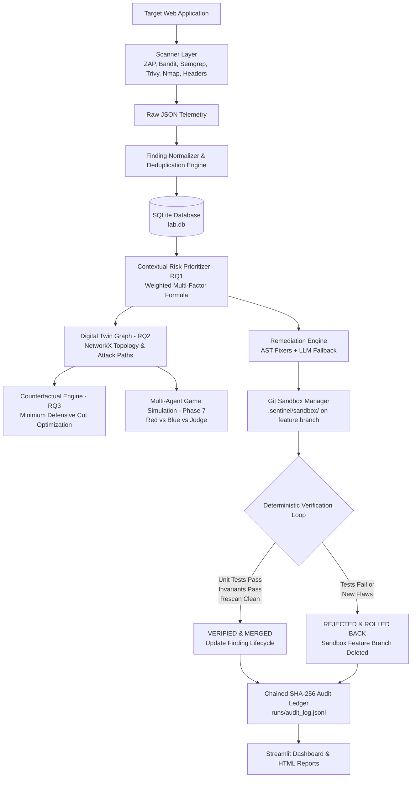
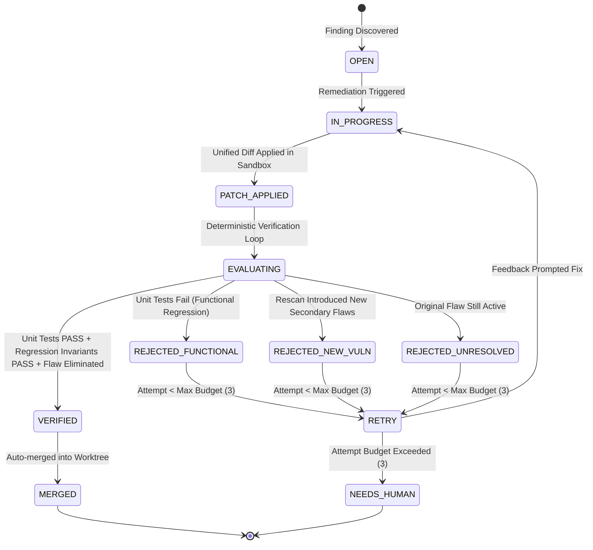

# VAPT-GPT Sentinel: System Architecture & Implementation Specification

## 1. Executive Summary & Core Principle

**VAPT-GPT Sentinel** is a defensive, closed-loop cybersecurity framework designed for academic research and automated vulnerability management.

> **Fundamental Cybersecurity Invariant:**
> The Large Language Model (LLM) **only proposes** candidate prioritizations, threat narratives, and unified patch diffs.
> **Deterministic test runners, security regression invariants, and targeted rescanners decide acceptance.**
> No patch is ever merged into the primary repository worktree without passing deterministic functional tests and proving flaw elimination.

---

## 2. Six Hard Safety Boundaries

1. **Strict Scope Allowlist (`config/scope.yaml`)**:
   - Every network scanner and HTTP client is gated through `ScopeGuard.validate_target(target)`.
   - Hostnames outside allowlist or forbidden ports immediately abort with `ScopeViolationError`.
2. **Explicit Target Ownership Authorization (`.env`)**:
   - `SENTINEL_I_OWN_THIS_TARGET=true` is non-negotiable. If omitted or false, execution halts with `UnauthorizedTargetError`.
3. **No Exploit Weaponization**:
   - Only baseline, non-destructive, non-DoS scanner modes are permitted.
   - Zero exploit payloads, shells, or persistence mechanisms are generated.
4. **Isolated Git Sandbox Execution**:
   - Patches are applied to an isolated working tree clone at `.sentinel/sandbox/` on temporary feature branches (`sentinel/fix-...-att<n>`).
   - The user's primary working tree remains untouched during remediation.
5. **Human Gate on High-Risk Security Categories**:
   - Flaws categorized under Authentication Logic (`CWE-287`), Access Control / IDOR (`CWE-639`, `CWE-284`), or Payments require explicit human approval (`NEEDS_HUMAN`) and are never auto-merged.
6. **Append-Only Tamper-Evident Audit Ledger (`runs/audit_log.jsonl`)**:
   - Cryptographically chained with SHA-256 hashes ($Hash_n = \text{SHA256}(\text{Payload}_n || Hash_{n-1})$).
   - Any modification to past events breaks the hash chain.

---

## 3. Core Modules & Research Contributions

### Research Question 1 (RQ1): Contextual Risk Prioritization
Traditional vulnerability management relies strictly on CVSS Base Scores, ignoring runtime exposure and asset criticality. Sentinel computes a deterministic contextual risk score:
$$\text{Score} = w_1 \cdot (\text{CVSS} \times 10) + w_2 \cdot (\text{EPSS} \times 100) + w_3 \cdot \text{Reachability} + w_4 \cdot \text{DataSensitivity} + w_5 \cdot \text{GraphCentrality}$$

### Research Question 2 (RQ2): Digital Twin Attack Path Modeling
Sentinel maps components, vulnerabilities, and crown jewels into a NetworkX directed graph:
- **Cumulative Path Probability:** $P(\pi) = \prod_{e \in \pi} P(e)$
- **System Attack Surface Risk Score:**
  $$\text{Risk}_{\text{system}} = \min\left(100, \sum_{\text{jewel} \in \mathcal{J}} \left[ 1 - \prod_{\pi \in \Pi(\text{jewel})} (1 - P(\pi)) \right] \cdot \text{Criticality}(\text{jewel}) \times 100\right)$$

### Research Question 3 (RQ3): Counterfactual Minimum Defensive Change
Solves the combinatorial cut problem:
$$\mathcal{I}^* = \arg\min_{\mathcal{I}} \text{Cost}(\mathcal{I}) \quad \text{subject to} \quad \Delta \text{Risk}(\mathcal{I}) \ge \tau$$
Identifies the minimal defensive intervention set that neutralizes the most critical threat trajectories at minimal operational friction.

### Multi-Agent Digital Twin Simulation (Phase 7)
- **Red Adversary Agent:** Maximizes adversarial attack utility $\text{Utility}(\pi) = \frac{P(\pi) \cdot \text{Criticality} \cdot 10}{\max(0.5, \text{Cost})}$.
- **Blue Defender Agent:** Selects cost-effective countermeasures (`PATCH_FINDING`, `REQUIRE_AUTH`, `ISOLATE_NODE`).
- **Judge Arbiter Agent:** Applies graph state mutations, computes $\Delta\text{Risk}$, and detects **adversary path displacement**.
- **Constraint:** Purely in-memory graph operations (**0 network packets transmitted**).

---

## 4. Verification State Machine

